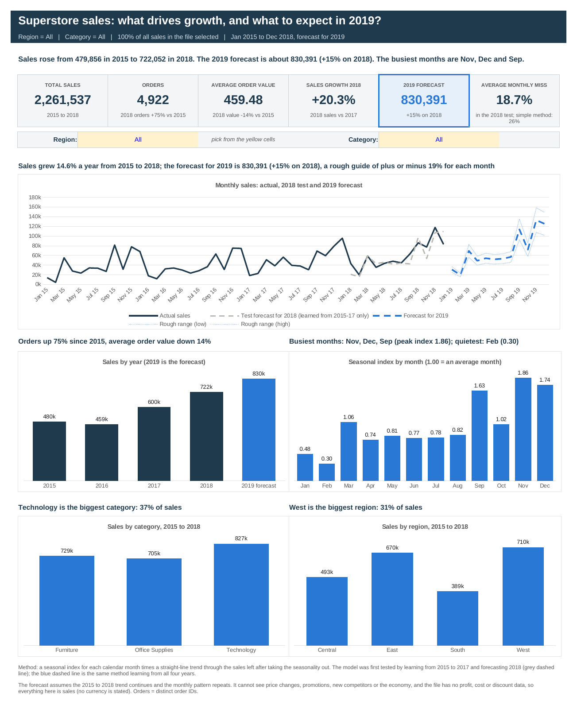
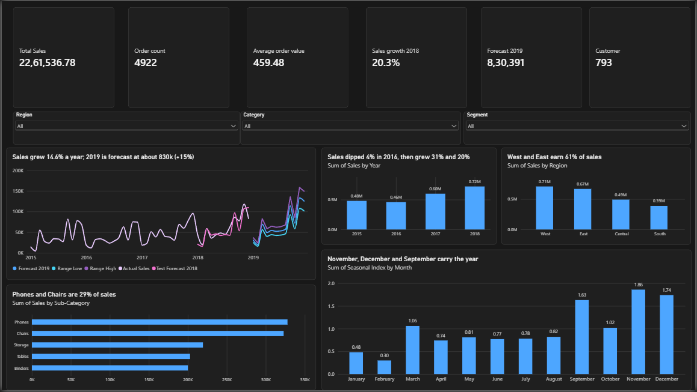

# Superstore Sales Analytics (2015-2018): growth drivers and a tested 2019 forecast

## Overview

A 4-year US retail sales file (9,800 order lines, 4,922 orders, 793 customers, 2,261,536.78 in sales) analysed from start to finish. A MySQL analysis finds where growth comes from and which months, products and regions matter. An Excel dashboard with a built-in forecasting model lets a reader slice the business by region and category. The 2019 forecast is tested on 2018 before it is trusted. A Power BI dashboard shows the same figures with three dropdown filters.

**Built with:** MySQL 8 (CTEs, window functions), Excel (formulas, charts, dropdown filters), Power BI (DAX measures, filters, charts).

> **Status:** complete: the SQL analysis, the forecast, the Excel dashboard and the Power BI dashboard.

## Business questions

1. How fast is the business growing, and does the growth come from more orders or bigger orders?
2. Which months, categories, sub-categories and regions matter most?
3. Are customers coming back, and is the store still winning new ones?
4. How concentrated is revenue across customers, states and products?
5. What should 2019 look like, and how far can the forecast be trusted?

## Key findings

**The business is growing on repeat orders: not on bigger orders, and not on new customers.**

- **Sales grew 14.6% a year, but unevenly.** 479,856 in 2015 and 722,052 in 2018: down 4.3% in 2016, then up 30.6% in 2017 and 20.3% in 2018.
- **Growth came from more orders, not bigger ones.** Orders rose 75% (947 to 1,661) while average order value fell 14% (506.71 to 434.71). Active customers rose only 17% (589 to 690), so each one ordered more often: 1.61 orders in 2015, 2.41 in 2018.
- **New customers have almost dried up.** Customers placing their first order in the file: 589 in 2015 (the first year, so everyone), then 141, 52 and 11. The 11 new customers in 2018 made 1.0% of that year's sales; 99% came from customers who had bought before.
- **Three months carry the year.** November (15.5% of sales), December (14.2%) and September (13.3%) earn 43.0% between them. January and February together earn 6.8%.
- **2019 is forecast at 830,391, 15.0% above 2018**, with a rough range of about plus or minus 19% for each month (see below).

Other findings:

- **The three categories are balanced, but Office Supplies is growing fastest.** Technology is 36.6% of sales, Furniture 32.2% and Office Supplies 31.2%. Office Supplies is 60.3% of order lines but only 31.2% of sales. In 2018 it grew 31.8%, Technology 21.4% and Furniture 8.4%.
- **Two sub-categories earn 29% of sales.** Phones (14.5%) and Chairs (14.3%) together are 28.8%; the top five (Phones, Chairs, Storage, Tables, Binders) are 56.3%. In 2018 Machines fell 22% and Envelopes 24%, while Tables were flat.
- **West and East earn 61% of sales, and Central shrank in 2018.** West is 31.4%, East 29.6%, Central 21.8% and South 17.2%. In 2018 West grew 36.0%, South 30.6% and East 17.7%, while Central fell 2.8%. California and New York alone are 33.3% of sales, and the top ten states 69.1%.
- **Segments differ in volume, not order size.** Consumer is 50.8% of sales, Corporate 30.4% and Home Office 18.8%, but average order values are within about 5% of each other (452.53, 461.77 and 475.37).
- **Customer revenue is concentrated, but not 80/20.** The top tenth of customers (80 of 793) make 31.2% of sales, the top fifth 48.7% and the bottom half 19.5%.
- **Shipping:** Standard Class is 59.8% of orders and takes 5.0 days on average (3 to 7); Second Class takes 3.2 days, First Class 2.2 days and Same Day under a day.

## The 2019 forecast

**Method.** A seasonal index for each calendar month (a month's sales divided by that year's average month, averaged over the years); divide each month by its index to remove the seasonal pattern; fit a straight line through what is left; extend the line 12 months and multiply by the index again. It is built from formulas in Excel (`Forecast` sheet) and in SQL (query 12), and both give the same answer.

**Test before trust.** The method first learned from 2015 to 2017 only and forecast 2018:

| | Forecast total for 2018 | Miss on the total | Average monthly miss |
|---|---|---|---|
| Seasonal index and trend (used) | 681,258 | 5.6% low | 18.7% |
| Holt-Winters (a standard method) | 599,693 | 17.0% low | 20.8% |
| Same month last year | 600,193 | 16.9% low | 25.7% |

Actual 2018 sales were 722,052. The average monthly miss is the total of the monthly misses (ignoring plus or minus) divided by total actual sales. In an earlier test (learn from 2015 and 2016, forecast 2017) the same method missed by 21.7% a month and its annual total was 17.0% low. Both tests came out low, because sales grew faster than the straight line expected.

**Result.** The forecast for 2019 is **830,391, 15.0% above 2018**. The busiest months are November (133,061), December (125,186) and September (113,858); the quietest is February (19,798). The plus or minus 19% is the size of the 2018 test miss. It is not a statistical confidence interval, and single months (January, February, December) can miss by much more.

**What could make it wrong.**
- The test years suggest the straight line may be too low, but the customer finding points the other way: growth came from existing customers ordering more often, with almost no new customers. If orders per customer stop rising, 2019 could come in below the forecast. With 48 months of data there is no way to tell which effect wins.
- The forecast assumes the 2015 to 2018 trend and monthly pattern continue. It cannot see price changes, promotions, competitors or the economy.
- Slices are much noisier than the whole business. In the Excel dashboard, the 2018 test miss ranges from 22% to 98% a month across the region and category combinations, and the dashboard shows a warning when the miss is above 30%.

## Recommendations

These are suggestions from sales data only. The file has no profit, cost or discount data, so check margins before acting on any of them.

- **Restart customer acquisition.** Growth depends on existing customers ordering more often (1.61 to 2.41 orders each) while first-time customers fell from 141 to 11 a year. Test ways to win new customers, and track orders per customer every quarter: if it stops rising, growth will slow.
- **Plan around the calendar.** Stock and staff for September, November and December (43% of sales). Treat January and February (6.8%) as the quiet months, and consider using them to test promotions that might even out demand.
- **Find out why Central shrank.** It was the only region to fall in 2018 (down 2.8%) while West, South and East grew 36.0%, 30.6% and 17.7%. Compare Central's products, customers and service with East and West.
- **Review Furniture before investing more.** It grew 8.4% in 2018 against 31.8% for Office Supplies, Tables were flat and Machines fell 22%. Check the margins on these lines first.
- **Use the forecast as a planning range, not a target.** Plan around 830k with a lower case in case repeat orders level off, and re-run the forecast as each quarter's actuals arrive.

## Tools used and methodology

**MySQL 8** (`superstore_analysis.sql`). A view turns the day/month/year text dates into real dates and gives every column a short name; each query then reads from that view. The 12 queries use CTEs, window functions (LAG for growth and moving averages, RANK inside each category, NTILE for customer deciles) and CASE-based year-by-year tables. The forecast is written in plain SQL (seasonal index, then a least-squares line from SUM formulas) and runs for any training year through one variable. Data checks: row count, date range and total sales against expected values; 11 blank postal codes (all Burlington, Vermont) and 32 Product IDs with more than one product name were found and do not affect the analysis.

**Excel** (`Superstore_Sales_Forecast.xlsx`). The `Data` sheet holds the 9,800 rows plus calculated helper columns (month, year and one-per-order flags, so orders are counted as distinct order IDs). The `Forecast` sheet builds the model with AVERAGEIFS and INDEX for the seasonal index, SLOPE and INTERCEPT for the trend, and SUMPRODUCT for the test errors. The `Dashboard` has six KPI cards and five charts, and two dropdowns (Region and Category) drive every figure through SUMIFS and COUNTIFS, including captions that rewrite themselves.

**Power BI.** One page built in the Power BI service from three small tables prepared from the same data (the order lines, the monthly sales with the forecast, and the seasonal index): six KPI cards, three dropdown filters (Region, Category, Segment), five charts including the forecast, and three short DAX measures (order count, average order value, 2018 sales growth). The forecast line, the Forecast 2019 card and the seasonal chart come from separate tables, so they always show the whole business and ignore the dropdowns.

**Checking the work.** Results were reproduced independently in DuckDB and Python (pandas), and the Excel workbook reconciles to the SQL results on its `About` sheet. All 20 Region and Category dropdown combinations were checked against an independent Python forecast. The Power BI cards and charts were compared with the same SQL results. The Holt-Winters comparison was run in Python (statsmodels); that script is not part of this repository. The MySQL file was checked by parsing it as MySQL and running it on the same data in another engine; it has not been run on a MySQL server and needs MySQL 8.0 or later.

## Limitations

- Four years (48 months) of data is a short history for forecasting.
- Sales only: no profit, cost, quantity, discount or currency.
- The customer list looks fixed (793 customers, almost no new ones after 2016), which is unusual for a real business.
- No causal claims: for example, the link between ordering more often and sales growth is an association in this data, not proof of cause.
- Practice dataset, not data from a real business: its tidy structure is not typical of real sales.

## Dashboard

**Excel** - six KPI cards, the monthly forecast, sales by year, seasonality, category and region. Pick a Region and a Category in the yellow cells and everything recalculates.

[`Superstore_Sales_Forecast.xlsx`](Superstore_Sales_Forecast.xlsx) also contains the `Forecast` sheet (the model step by step), `About` (method, definitions and the check against the SQL), `Calc` (helper tables) and `Data` (the 9,800 rows). The CSV is not included as a separate file; the same rows are on the `Data` sheet.

**Power BI** - six KPI cards, three dropdown filters (Region, Category, Segment), the monthly sales with the 2019 forecast and its range, sales by year, the top five sub-categories, sales by region, and the seasonal index. Built in the Power BI service; the report file itself is not in this repository.

## Files

| File | What it is |
|---|---|
| [`superstore_analysis.sql`](superstore_analysis.sql) | 12 MySQL queries: KPIs, growth by year and month, seasonality, category and sub-category, region and state, segment, customers, shipping, and the forecast with its 2018 test |
| [`Superstore_Sales_Forecast.xlsx`](Superstore_Sales_Forecast.xlsx) | Excel dashboard with two filters, the forecasting model, and the data |
| [`superstore_excel_dashboard.png`](superstore_excel_dashboard.png) | Picture of the Excel dashboard shown above |
| [`superstore_powerbi_dashboard.png`](superstore_powerbi_dashboard.png) | Picture of the Power BI dashboard shown above |

## How to run

1. In MySQL Workbench, import the sales file into a table called `train` (right-click Tables, then Table Data Import Wizard), inside a database called `Superstore`.
2. Open `superstore_analysis.sql` and run each query on its own. Query 0 creates the view, and its check should return 9800 rows, first order 2015-01-03, last order 2018-12-30 and total sales 2261536.78.
3. For the forecast (query 12), select the `SET @last_year` line together with the query. Use 2017 to test the method on 2018 and 2018 to forecast 2019.
4. For Excel, open the workbook and go to the `Dashboard` sheet. Pick a Region and a Category in the yellow cells.
